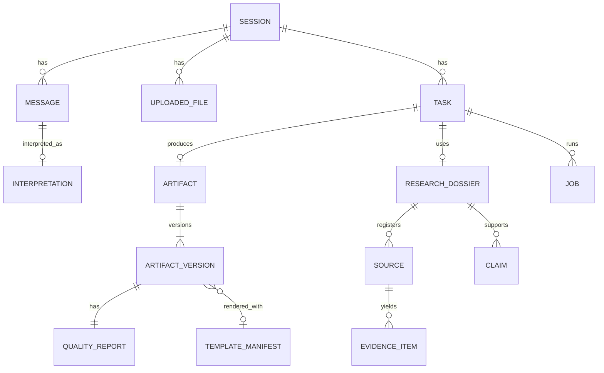

# DocForge — Data Models and Contracts

Authoritative definitions live in `src/docforge/models/` as Pydantic v2 models. This document explains their purpose, relationships and invariants. Every persisted JSON document carries `schema_version`.

## 1. Entity overview



IDs are prefixed ULID-style strings (`ses_…`, `msg_…`, `fil_…`, `tsk_…`, `art_…`, `src_…`, `evd_…`, `clm_…`, `job_…`). Unit IDs inside IR are short stable slugs (`s01`, `sec-2-1`, `sh-calc`).

## 2. Conversation (`models/conversation.py`)

| Model | Key fields | Notes |
|---|---|---|
| `Session` | `id, owner, title, created_at, active_task_id` | `owner` = authenticated username (ADR-015). |
| `Message` | `id, session_id, role (user/assistant/system), content, file_ids[], created_at, interpretation_id?` | Assistant messages carry status / clarification text. |
| `UploadedFile` | `id, session_id, filename, media_type, size, sha256, role (template/source/dataset/unknown), blob_path` | Role is user-declared or inferred. |
| `Task` | `id, session_id, objective, output_spec, status, artifact_id?, dossier_id?, template_file_id?, source_file_ids[]` | One deliverable per task. |
| `Job` | `id, task_id, kind (generate/edit/regenerate), status, stage, checkpoint, progress[], error?` | |

## 3. Interpretation (`models/intent.py`)

```text
Interpretation
  kind: new_task | continue_task | modify_artifact | regenerate | change_objective | clarification_answer | question
  confidence: 0..1
  objective: str                    # restated goal
  output_spec: OutputSpec?
  change: ChangeRequest?            # for modify/regenerate
  research: ResearchNeed            # depth none|light|standard|deep + rationale
  clarification_questions: [ClarificationQuestion]
  assumptions: [str]
  referenced_file_ids: [str]

OutputSpec
  format: pptx | docx | xlsx
  purpose, audience, tone, language (BCP-47), detail_level (brief|standard|detailed)
  length: LengthSpec{unit: slides|pages|words|sheets|auto, target?, min?, max?, explicit: bool}
  citation_style: numeric | apa | harvard | none
  style_notes: [str]

ChangeRequest
  operation: restyle | rewrite | add | remove | reorder | expand | condense | replace_data | regenerate | convert_format
  scope: ChangeScope{level: artifact|unit|element|style, targets: [TargetRef]}
  instruction: str
  style_changes: [StyleChange]?     # property path + value, for deterministic restyle

TargetRef
  kind: slide | section | sheet | element | table | chart | paragraph | style
  locator: str                      # as the user said it: "slide 4", "the revenue chart"
  resolved_unit_id: str?            # filled by the orchestrator
```

Invariant: `kind == modify_artifact` ⇒ `change` present; unit-level scope ⇒ ≥1 target.

## 4. Research and evidence (`models/evidence.py`)

```text
ResearchPlan
  depth, questions: [ResearchQuestion{id, question, priority 1-3, rationale, query_hints[]}]

Source
  id, kind: web | user_file | dataset
  url?, file_id?, title, publisher?, author?, published_at?, retrieved_at
  authority: high | medium | low, authority_rationale
  relevance: 0..1, content_sha256, excerpt

EvidenceItem
  id, source_id, kind: fact | figure | finding | quote | definition | opinion
  statement, value?, unit?, as_of?, locator (page/section/anchor/quote span)
  question_ids[], confidence: 0..1

Claim
  id, text, evidence_ids[]
  status: supported | partially_supported | unsupported | assumption | interpretation | estimate
  note?

Conflict { claim_or_topic, evidence_ids[], description }
Gap      { question_id, description }

ResearchDossier
  id, task_id, plan, sources[], evidence[], claims[], conflicts[], gaps[]
  coverage: {answered, partial, unanswered}, performed: bool, skipped_reason?
```

Invariants: every `EvidenceItem.source_id` exists; every `Claim.evidence_ids` resolve; `status == supported` ⇒ ≥1 evidence ID.

## 5. Templates and design (`models/template.py`, `models/design.py`)

```text
TemplateManifest
  id, format, file_sha256, schema_version
  page: {width_emu, height_emu} | docx PageSetup | null
  theme: ThemeSpec{colors: {dk1, lt1, dk2, lt2, accent1..6, hlink}, major_font, minor_font}
  pptx: PptxTemplateInfo?   masters[], layouts[LayoutSpec], sample_slides[SlideInventory]
  docx: DocxTemplateInfo?   styles[StyleInfo], sections[SectionInfo], has_toc, sample_paragraph_count
  xlsx: XlsxTemplateInfo?   sheets[SheetInfo], defined_names[], tables[], charts[]
  warnings[]

LayoutSpec     {id, name, master_index, archetype, placeholders[PlaceholderSpec], elements[ElementSpec]}
PlaceholderSpec{idx, type (title/body/subtitle/picture/chart/table/date/footer/slide_number/object), bbox, font_size?}
ElementSpec    {id, name, kind (text/picture/shape/group/table/chart/line/placeholder/other), bbox: Box,
                z, role (structural/branding/decorative/placeholder/sample_content), text?, fill?, font?}
Box            {x, y, w, h} in EMU

DesignTokens
  palette: {background, surface, text, text_muted, primary, secondary, accents[], positive, negative}
  fonts: {heading, body, mono}
  type_scale: {title, h1, h2, body, caption, footnote} in pt
  spacing: {margin, gutter, grid_columns}
  source: template | generated
```

## 6. Intermediate representations (`models/ir.py`)

All IR documents share: `schema_version`, `title`, `style: StyleSpec`, `units` with stable IDs, claim references.

### 6.1 Content blocks (shared)

Discriminated union on `type`:

| Block | Fields |
|---|---|
| `paragraph` | `text, claim_ids[]` |
| `bullets` | `items[{text, level 0-2, claim_ids[]}]` |
| `table` | `columns[], rows[[cell]], caption?, claim_ids[]` |
| `chart` | `chart_type (bar/column/line/pie/doughnut/area/scatter/stacked_bar/stacked_column), categories[], series[{name, values[]}], unit?, title?, claim_ids[]` |
| `timeline` | `events[{label, date?, description?}]` |
| `process` | `steps[{title, description?}]` |
| `comparison` | `columns[{heading, points[]}]` |
| `kpi` | `metrics[{label, value, delta?, note?, claim_ids[]}]` |
| `quote` | `text, attribution?, claim_ids[]` |
| `image` | `description, file_id?, alt_text` |
| `callout` | `text, tone (info/positive/warning)` |

### 6.2 DeckPlan

```text
DeckPlan
  title, subtitle?, audience, narrative: [str]      # storyline beats
  design_hint?                                     # palette name for generated designs (no template)
  slides: [SlidePlan]
SlidePlan
  id, purpose, archetype, headline, key_message, blocks[], notes?, claim_ids[]
  layout_hint?                                     # template layout id chosen by composer
```

Archetypes: `title, agenda, section, bullets, two_column, comparison, timeline, process, chart, table, kpi, quote, image_text, summary, closing, references`.

### 6.3 DocumentPlan

```text
DocumentPlan
  title, subtitle?, author?, doc_type (report/memo/proposal/paper/brief/manual)
  front_matter: {executive_summary?: [blocks], abstract?: str, include_toc: bool}
  sections: [SectionPlan{id, heading, level 1-3, purpose, blocks[], subsections[]}]
  references: auto from claims
```

### 6.4 WorkbookPlan

```text
WorkbookPlan
  title, sheets: [SheetPlan]
  named_ranges: [{name, sheet_id, ref}]
  checks: [ExpectedValue{sheet_id, cell, expected, tolerance, rationale}]
SheetPlan
  id, name (≤31 chars, unique), role: readme | assumptions | data | calculations | report | sources
  tables: [TableSpec{name, anchor, columns[ColumnSpec], rows[[value|formula]]}]
  cells: [CellSpec{ref, value | formula, number_format?, style_role?}]
  charts: [ChartSpec{chart_type, title, data_ref, categories_ref, anchor}]
  conditional_formats[], validations[], freeze?
ColumnSpec {name, dtype (text/int/float/currency/percent/date/bool), unit?, number_format?, formula_template?}
```

Formula function whitelist is defined in `docforge.render.xlsx_functions` (ADR-011).

### 6.5 StyleSpec

Format-agnostic overrides applied after template/design tokens:

```text
StyleSpec
  heading_font?, body_font?, heading_sizes_pt{h1,h2,h3,title}?, body_size_pt?
  palette_overrides{}?, line_spacing?, paragraph_spacing_pt?, margins_in?
```

Restyle edits change only `StyleSpec` (deterministic, no LLM).

## 7. Editing (`models/edit.py`)

```text
IRPatch
  base_version: int
  ops: [PatchOp{op: add|remove|replace|move, path: JSON-Pointer, value?, from?}]
  affected_unit_ids: [str]
  rationale: str
```

Scope guard: each op path must resolve inside an affected unit (or `/style` for restyle). Ops outside are rejected and reported.

## 8. Artifacts (`models/artifact.py`)

```text
Artifact          {id, task_id, format, current_version}
ArtifactVersion   {artifact_id, version, parent_version?, ir (json), template_file_id?,
                   design_tokens, blob_path, change_summary, quality_report_id, dossier_id?, created_at}
```

## 9. Quality (`models/quality.py`)

```text
Finding
  id, check_id, dimension (content/structure/layout/typography/data/evidence/template/accessibility/validity)
  severity: info | minor | major | critical
  unit_id?, element?, message, details{}
  status: detected | corrected | unresolved
  repair_action?

CheckResult  {check_id, status: passed | failed | skipped | error, reason?, duration_ms}
QualityReport
  artifact_id, version, iterations, checks[], findings[]
  summary {detected, corrected, unresolved, skipped}
  verdict: pass | pass_with_warnings | fail
```

Verdict: `fail` if any unresolved critical; `pass_with_warnings` if unresolved major/minor or skipped tier-1/2 checks; otherwise `pass`.

## 10. LLM call log (`models/llm.py`)

`LLMCallRecord {id, agent, provider, model, request_hash, usage{input_tokens, output_tokens}, finish_reason, attempts, fallback_used, duration_ms, job_id?, replayed, created_at}` — content not stored unless cassette recording is on. `finish_reason` is normalised across providers to `stop | length | blocked | other`.

## 10a. Retrieval (`retrieval/*`)

`VectorRecord {id, values[], metadata{source_id, chunk, title, text}}` stored per namespace (chat session). `RetrievedChunk {chunk_id, source_id, text, score, locator}` is what agents receive; `locator` feeds `EvidenceItem.locator`.

## 11. Versioning of schemas

`schema_version` uses `MAJOR.MINOR`. Minor = additive optional fields. Major = migration function in `docforge.models.migrations` required.

## 12. Additions (2026-10-17)

- `PptxTemplateInfo.design_mode`: `layouts` (artwork on masters/layouts) or `slides` (artwork on sample slides; clone mode, ADR-019).
- `PptxTemplateInfo.slide_bases: list[SlideBase]` — per usable sample slide: `kind` (cover|content|section|closing|diagram), `title_shape`, `subtitle_shape`, `remove_shapes`, `photo_shapes`, `frame_shapes` (indices into `slide.shapes`), `region` (content area, EMU), `region_color`, `score`.
- `PptxTemplateInfo.slide_fonts`, `slide_palette`, `slide_text_color`, `slide_background` — style taken from the sample slides.
- `TemplateManifest.analyzer_version` — cached manifests older than `ANALYZER_VERSION` are recomputed.
- `Message.artifact_ref` — deliverable produced by a reply (download card after reload).
- `ArtifactVersion.preview_paths` — PNG blobs of the first slides (chat thumbnails).
