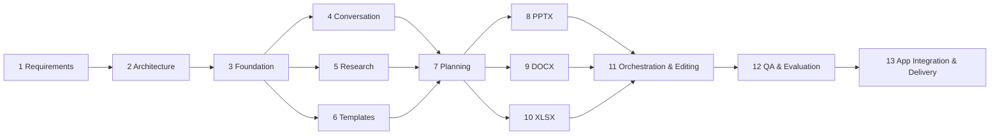

# DocForge — Implementation Plan

Status values: `planned` · `active` · `done` (code exists) · `verified` (meets TESTING §6). Current status per stage lives in [STATUS](STATUS.md).

## Dependency graph

Stages 4, 5 and 6 can proceed in parallel. 8, 9 and 10 can proceed in parallel once 7's IR schemas are frozen. A thin vertical slice (Milestone M1) cuts across stages early to de-risk integration.

## Milestones

| Milestone | Content | Exit criterion |
|---|---|---|
| M0 Foundation | Stages 1–3 | Docs approved; `pytest` green; app boots; `/health` OK |
| M1 Vertical slice | Minimal 4/7/8: prompt → DeckPlan (fake or live LLM) → PPTX without template → validated | E2E replay test produces valid 5-slide deck with zero critical findings |
| M2 Research & templates | Stages 5, 6 complete | Fixture research produces dossier with coverage; PPTX/DOCX/XLSX manifests for all fixtures |
| M3 All formats | Stages 7–10 | S1–S6 pass offline |
| M4 Editing | Stage 11 | S7–S10 pass; edit precision 100 % |
| M5 Acceptance | Stages 12–13 | All AC-1…AC-10 pass; final acceptance report |

## Stages

### Stage 1 — Requirements and product definition
- **Purpose:** fix scope, scenarios, requirements, acceptance criteria.
- **Deliverables:** `docs/PRD.md` (scenarios, FR/NFR, AC, unresolved questions).
- **Verification:** requirements traceable to spec sections 3–12; every M requirement has an AC or test mapping.
- **Dependencies:** none.

### Stage 2 — Architecture and system design
- **Deliverables:** `ARCHITECTURE.md` (components, sequence & lifecycle diagrams, security, errors), `DECISIONS.md` (ADR-001…013), `DATA_MODELS.md`, `QUALITY.md`, `TESTING.md`.
- **Verification:** every FR mapped to a component; data contracts defined for each agent boundary.
- **Dependencies:** 1.

### Stage 3 — Repository and implementation foundation
- **Scope:** package layout, `pyproject.toml`, config (`pydantic-settings`), structured logging, error taxonomy, ID generation, Pydantic models (all of DATA_MODELS), SQLAlchemy storage + blob store, vendor-neutral `LLMClient` gateway (Gemini and OpenAI-compatible REST adapters, fake, record/replay), search providers (Tavily, dev fallback, fixtures), retrieval (embeddings, Pinecone/local vector store), JWT auth, FastAPI app with health/auth/session/upload endpoints, CLI skeleton, test harness.
- **Deliverables:** runnable app, `DEPLOYMENT.md`, baseline tests.
- **Verification:** `pytest` green; `uvicorn docforge.api.app:app` serves `/health`; models round-trip JSON; storage CRUD tests; LLM gateway tests with fake transport.
- **Dependencies:** 2.

### Stage 4 — Request understanding and conversation context
- **Scope:** `ConversationContextBuilder` (recent turns, task state, artifact outline with unit IDs, file roles), `InterpreterAgent` prompt + schema, target resolution (ordinal/title/semantic match over outline), clarification policy, format inference.
- **Deliverables:** interpreter, context builder, target resolver, tests over a labelled set of ≥ 40 utterances (new/continue/modify/regenerate/ambiguous).
- **Verification:** classification accuracy ≥ 90 % on labelled set (replay); target resolution 100 % on deterministic ordinal/title cases; ambiguous cases yield clarification.
- **Dependencies:** 3.

### Stage 5 — Research and evidence management
- **Scope:** research planner and query generation over the `SearchProvider` (Tavily; providers already built in Stage 3), source registration and authority rating, ingestion of user sources, evidence extraction per source, conflict/gap detection, claim registry, coverage, budgets.
- **Deliverables:** `docforge.research`, `docforge.ingest`, dossier persistence, research-quality tests.
- **Verification:** fixture research end-to-end; invariants (DATA_MODELS §4) enforced; coverage computed; unverifiable topics produce gaps.
- **Dependencies:** 3.

### Stage 6 — Template analysis and reusable design representation
- **Scope:** PPTX analyzer (theme XML, masters, layouts, placeholders, sample-slide element inventory, role classifier, archetype classifier), DOCX analyzer (styles, sections, headers/footers, numbering), XLSX analyzer (sheets, tables, names, formulas, charts), design tokens, design system for no-template output, programmatic fixtures.
- **Deliverables:** `docforge.template`, `docforge.design`, manifests for every fixture.
- **Verification:** manifest snapshot tests; role classification correct on fixtures (logo → branding, sample text → sample_content); archetype classification for standard layouts.
- **Dependencies:** 3.

### Stage 7 — Content planning and synthesis
- **Scope:** planner + writer agents for three formats, dossier digesting, plan validators (length, duplicates, citations, archetype fit), claim linkage.
- **Deliverables:** plan generation, validation rules, content-quality tests.
- **Verification:** validators catch seeded defects; replayed plans satisfy constraints.
- **Dependencies:** 4, 5, 6.

### Stage 8 — PowerPoint generation
- **Scope:** layout engine (archetype geometry, grid), text measurer + fitting, PPTX renderer (template and no-template paths), native charts/tables/diagrams, references slide, notes, PPTX checks + repairers, optional visual rendering.
- **Deliverables:** PPTX pipeline, component library, render-and-repair loop, visual regression tests.
- **Verification:** QUALITY §2.2 checks green on fixtures; any slide count with 3 template fixtures; manual spot check recorded.
- **Dependencies:** 7.

### Stage 9 — Word document generation
- **Scope:** DOCX renderer (title page, TOC field, headings, lists, tables, chart images, captions, citations/references, header/footer/page numbers), template path, style overrides, DOCX checks.
- **Verification:** QUALITY §2.3 checks; template style reuse; heading-size edit only touches styles.
- **Dependencies:** 7.

### Stage 10 — Excel workbook generation
- **Scope:** dataset ingestion/cleaning, workbook renderer (tables, formats, named ranges, formulas, charts, conditional formats, validation), formula engine verification, XLSX checks.
- **Verification:** QUALITY §2.4 checks; expected values pass; seeded formula errors detected.
- **Dependencies:** 7.

### Stage 11 — Cross-format orchestration and artifact editing
- **Scope:** full orchestrator state machine, job runner + checkpoints + SSE, artifact versioning, EditorAgent, IR patch application + scope guard + regression diff, deterministic restyle path, format conversion (reuse dossier), revert, import of external files to IR (S).
- **Verification:** S7–S10 E2E pass; edit precision 100 % on edit regression set.
- **Dependencies:** 8, 9, 10.

### Stage 12 — Quality assurance and evaluation
- **Scope:** evaluation dataset (S1–S11 × variants), `docforge eval` runner, metrics report, human-rating sheets, visual regression baselines, limitations record.
- **Verification:** metrics in TESTING §5 meet targets or are recorded as limitations with rationale.
- **Dependencies:** 11.

### Stage 13 — Application integration and delivery
- **Scope:** web UI completion, upload roles, download/version UI, quality report view, Alembic migrations, Docker image (with LibreOffice), monitoring hooks, user guide, final acceptance report.
- **Verification:** AC-1…AC-10; fresh-machine setup following DEPLOYMENT succeeds.
- **Dependencies:** 12.

## Change control

Any change touching more than one component updates: the affected docs (ARCHITECTURE / DATA_MODELS / QUALITY), a new or superseding ADR if a decision changes, and STATUS.
