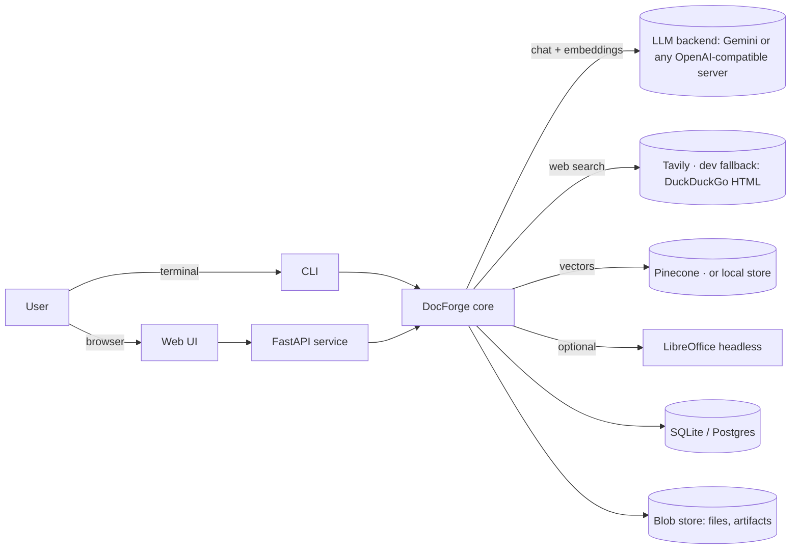
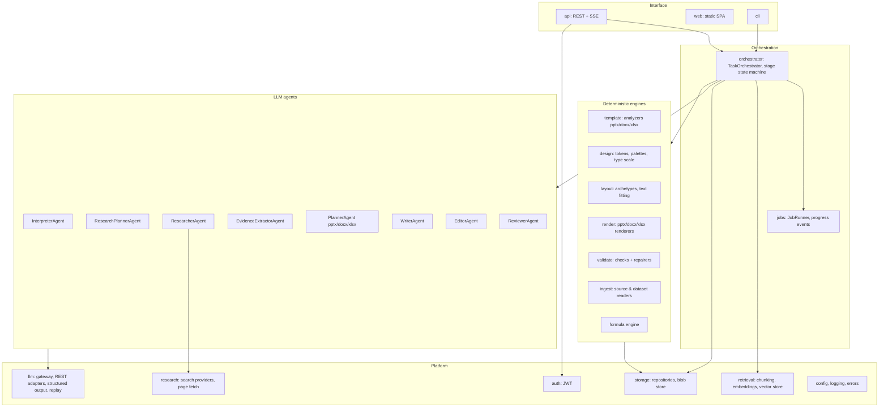
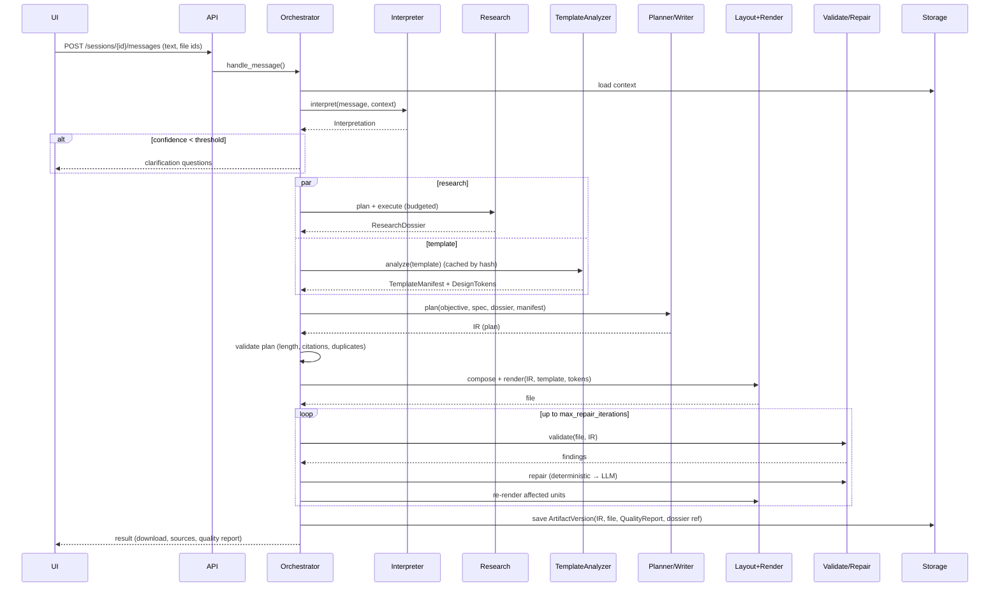
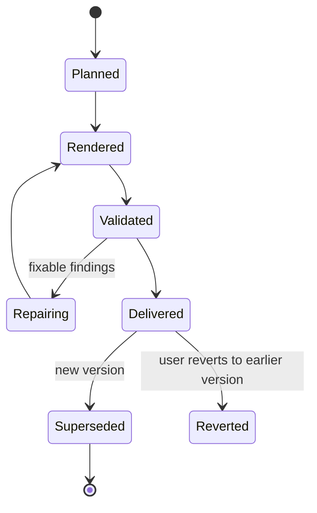

# DocForge — Architecture Specification

| Field | Value |
|---|---|
| Status | Baseline (Stage 2 complete) |
| Related | [PRD](../PRD.md) · [DECISIONS](DECISIONS.md) · [DATA_MODELS](../DATA_MODELS.md) · [QUALITY](../QUALITY.md) |

## 1. Architectural principles

1. **Code orchestrates, agents reason.** A deterministic orchestrator drives a staged workflow; LLM agents are called for bounded reasoning tasks with typed (Pydantic) inputs and outputs. No free-roaming agent loop owns the pipeline (ADR-002).
2. **The intermediate representation (IR) is the source of truth.** Every artifact version stores a format-specific plan (Deck/Document/Workbook IR). Files are *rendered* from IR + template + design tokens, deterministically. Edits are IR patches (ADR-003).
3. **Evidence is data.** Sources, evidence items and claims are first-class records referenced by ID from the IR (ADR-006).
4. **Templates are parsed, not pasted.** A template becomes a manifest + design tokens + a reusable package (masters/layouts/styles) that renderers build upon (ADR-007).
5. **Validate the file, not the intent.** Validators inspect the rendered file (and rendered images when possible). Unrun checks are reported as skipped (ADR-009).
6. **Everything replaceable behind an interface.** LLM provider, embedding provider, search provider, vector store, renderer, visual renderer, storage.
7. **Vendor-neutral.** No vendor SDKs; every external service is reached through a project-owned HTTP adapter chosen by configuration. Missing keys degrade a feature with explicit reporting (ADR-016).

## 2. System context



## 3. Component view



### 3.1 Component responsibilities

| Package | Responsibility | Key interfaces |
|---|---|---|
| `docforge.api` | HTTP endpoints, JWT-protected; upload handling, SSE progress, downloads. Thin: delegates to orchestrator. | FastAPI routers |
| `docforge.web` | Static single-page UI (chat, uploads, status, downloads, report viewer). | — |
| `docforge.cli` | `docforge generate`, `docforge edit`, `docforge analyze-template`, `docforge eval`. | Typer-free argparse CLI |
| `docforge.orchestrator` | Stage state machine for generate / edit / regenerate flows; budgets; resumability; emits progress events. | `TaskOrchestrator.handle_message()` |
| `docforge.conversation` | Session/task state, reference resolution context (artifact outline, recent turns), clarification policy. | `ConversationContextBuilder` |
| `docforge.agents` | One class per LLM role; each owns its prompt, input/output schema and post-validation. | `Agent[In, Out].run()` |
| `docforge.research` | Research plan execution, search providers (Tavily, dev fallback, fixtures), page fetch, source registry, evidence store, coverage. | `SearchProvider`, `EvidenceStore` |
| `docforge.retrieval` | Chunk, embed and search user sources; Pinecone or local vector store. | `KnowledgeIndex`, `VectorStore` |
| `docforge.research.academic` | Scholarly search: OpenAlex, Semantic Scholar, arXiv (ADR-017). | `SearchProvider` |
| `docforge.research.pipeline` | Research service: plan → multi-source search → rank → read → extract → dossier; evidence digest for planners. | `ResearchService`, `evidence_digest` |
| `docforge.media` | Image search, download, normalisation, credits (ADR-018). | `ImageProvider`, `resolve_deck_images` |
| `docforge.ingest` | Read user files into text/structured content for research and datasets (PDF, DOCX, PPTX, XLSX, CSV, TXT, MD). | `SourceReader` |
| `docforge.template` | Parse templates into `TemplateManifest`; classify elements and layouts; derive design tokens. | `TemplateAnalyzer` |
| `docforge.design` | Design tokens for no-template output; palettes, type scale, spacing grid, contrast checks. | `DesignSystem` |
| `docforge.layout` | Map slide archetype + content to geometry on a layout; text measurement and fitting. | `LayoutEngine`, `TextMeasurer` |
| `docforge.render` | Deterministic renderers IR → file for PPTX/DOCX/XLSX; PNG preview renderer for layout QA without LibreOffice. | `render_deck(...)`, `render_previews(...)` |
| `docforge.validate` | Format checks, repairers, quality report, optional visual rendering. | `Check`, `Repairer`, `QualityReport` |
| `docforge.llm` | Provider-neutral gateway: REST adapters (Gemini, OpenAI-compatible), schema-in-prompt structured output with validation/repair, retries, fallback model, embeddings, record/replay. | `LLMClient`, `ChatProvider`, `EmbeddingProvider` |
| `docforge.storage` | SQLAlchemy repositories + filesystem blob store; artifact versioning. | `Repository`, `BlobStore` |
| `docforge.models` | Pydantic schemas shared by all components (see DATA_MODELS). | — |
| `docforge.core` | Config, logging, error taxonomy, IDs, upload sniffing, JWT auth. | — |

## 4. Agent roster

All agents are called through `LLMClient` with structured outputs. Agents never touch files or the database directly; the orchestrator passes inputs and persists outputs.

| Agent | Input | Output | Notes |
|---|---|---|---|
| InterpreterAgent | message, conversation context (recent turns, task state, artifact outline, uploaded file roles) | `Interpretation` | Classifies request kind, output spec, change request, research need, clarification questions, assumptions, confidence. |
| ResearchPlannerAgent | objective, output spec, existing dossier | `ResearchPlan` (questions, priorities, query hints, depth) | Skipped when research depth = none. |
| ResearcherAgent | research question batch | search queries → `SourceCandidate[]` | Turns questions into queries for the configured `SearchProvider` (Tavily by default); results fetched/registered by code. |
| EvidenceExtractorAgent | source text chunk + questions | `EvidenceItem[]`, conflicts | Runs per source; extracts atomic, quotable facts with locators. |
| PlannerAgent | objective, output spec, dossier digest, template manifest summary | `DeckPlan` / `DocumentPlan` / `WorkbookPlan` skeleton | Information architecture + archetypes; claims linked to evidence. |
| WriterAgent | plan unit + relevant evidence + style guide | filled unit (blocks, notes, prose) | Called per slide/section for depth; parallelisable. |
| EditorAgent | change request + targeted IR units + context | `IRPatch` | Produces patches confined to resolved targets. |
| ReviewerAgent | rendered-content digest + plan + evidence | content findings | Repetition, shallowness, unsupported claims, tone mismatch. |

Small requests may merge Planner+Writer in one call (configurable) to save latency.

## 5. Core flows

### 5.1 Generation flow



Stages and their persisted checkpoints: `INTERPRETED → RESEARCHED → TEMPLATE_ANALYZED → PLANNED → WRITTEN → RENDERED → VALIDATED → DELIVERED`. A failed job resumes from the last checkpoint.

### 5.2 Edit flow

```mermaid
sequenceDiagram
  participant O as Orchestrator
  participant C as ContextBuilder
  participant I as Interpreter
  participant E as EditorAgent
  participant L as Render
  participant V as Validate
  O->>C: build context (artifact outline with unit IDs)
  O->>I: interpret("make slide 4 about costs")
  I-->>O: kind=modify, scope={slide: s4}, op=rewrite
  O->>O: resolve targets → unit IDs; check confidence
  alt style-only change
    O->>O: deterministic style patch (no LLM)
  else content change
    O->>E: edit(change, units[s4], neighbours digest, evidence)
    E-->>O: IRPatch (ops limited to s4)
  end
  O->>O: scope guard: reject ops outside targets
  O->>L: render new version (same template, same tokens)
  O->>V: validate changed units + global checks
  O->>O: regression diff: out-of-scope units unchanged
```

Style-only changes (font size, colours, spacing, tone-independent formatting) map to deterministic patches of the IR `style` section; DOCX style changes are applied to named styles.

### 5.3 Clarification policy

The orchestrator asks instead of acting when any holds:
- `Interpretation.confidence < CLARIFY_THRESHOLD` (default 0.6);
- target resolution yields 0 or >1 candidate units for a unit-scoped change;
- the change would rewrite > 50 % of units while the request names a narrower scope;
- required inputs are missing (e.g. "use my template" with no template uploaded).

Clarifications offer concrete options when possible.

## 6. Template-aware rendering strategy (PPTX)

1. Open the template package; keep masters, layouts, theme, embedded fonts and media.
2. Classify every sample-slide element (structural / branding / decorative / placeholder / sample content).
3. Delete all sample slides (relationships cleaned to avoid orphaned parts).
4. For each `SlidePlan`, choose a layout: score template layouts against the archetype (placeholder types and counts, geometry, layout name hints). If none fits, use the closest content layout and compose shapes inside its content region using design tokens from the theme.
5. Re-apply branding elements found on sample slides but not on layouts (e.g. a logo placed per slide) at their original geometry.
6. Fill placeholders; create additional shapes (charts, tables, diagrams) inside the content region computed by the layout engine.
7. Text fitting via `TextMeasurer` (font metrics with Pillow; fallback average-advance heuristic), with font-size floors per role.

DOCX: the template document is copied, body content removed while preserving the final section properties, headers/footers and styles; content is appended using template style names mapped by role (Title, Heading 1–3, Body, Caption, List Bullet, Table style).

XLSX: template sheets are classified by role; structures (headers, formats, formulas) are kept or regenerated per plan; sample data rows are removed when the plan supplies data.

## 7. Validation and repair architecture

`validate` holds a registry of `Check` objects keyed by format and dimension. Each returns `CheckResult` (passed / failed / skipped / error) plus `Finding`s. `Repairer`s are registered against finding types:

| Finding | Deterministic repair | LLM repair |
|---|---|---|
| Text overflow | reduce font to floor, tighten spacing, widen box within region | condense text to target length |
| Overflow persists | split slide into two (continuation) | — |
| Empty placeholder | remove placeholder | — |
| Leftover sample text | delete shape | — |
| Off-slide / overlapping element | snap into content region; re-layout | — |
| Formula error | fix reference via plan; recompute | regenerate formula from spec |
| Unsupported claim | mark as assumption / add limitation note | rewrite with available evidence |

Loop: validate → repair → re-render affected units → re-validate; stop when no fixable findings remain or `MAX_REPAIR_ITERATIONS` (default 3) reached.

Visual checks use `VisualRenderer` (LibreOffice → PDF → PNG via `pypdfium2`) when available.

## 8. Persistence

- **Relational store** (SQLAlchemy 2, SQLite default, Postgres-compatible): sessions, messages, files, tasks, jobs, interpretations, artifacts, artifact versions, research dossiers, sources, evidence, template manifests, quality reports, LLM call log.
- **Blob store** (filesystem, S3-compatible interface): uploaded files, rendered artifacts, rendered previews, LLM cassettes. Paths are content-addressed (`sha256/aa/bb...`).
- **Vector store** (ADR-014): Pinecone index (`PINECONE_INDEX`) or local vectors in the app database; one namespace per chat session.
- Large JSON documents (IR, manifests, dossiers) stored as JSON columns; schema version recorded in each document.

## 9. Error handling

Error taxonomy (`docforge.core.errors`): `DocForgeError` → `UserInputError` (4xx, actionable message), `UnsupportedFileError`, `TemplateError`, `ResearchError`, `LLMError` (`LLMRateLimited`, `LLMRefused`, `LLMOutputInvalid`), `RenderError`, `ValidationFailed`, `BudgetExceeded`, `StorageError`.

- Transient provider errors: SDK retries + orchestrator stage retry with backoff.
- Invalid structured output: one re-ask with the validation error, then fail the stage.
- Provider block (safety/policy): the gateway tries `LLM_FALLBACK_MODEL` once; if that also blocks, the reason is surfaced to the user; no silent placeholder content.
- A stage failure marks the job `failed` with the stage name; the user can retry (resumes from checkpoint).

## 10. Security boundaries

- Uploads: extension + magic-byte check; size limits; OOXML opened through libraries with defused XML (`defusedxml`), zip entry count/size limits to block zip bombs; macros stripped/never executed.
- Fetched web content is untrusted data: passed to agents inside delimited blocks; agents are instructed that source text cannot issue instructions; no tool can act on the system based on source text.
- Authentication: JWT bearer tokens on all `/api/*` routes except login; sessions are owner-scoped and foreign sessions look missing (ADR-015). Production start is refused while `JWT_SECRET` is the placeholder.
- Secrets only via environment / `.env` (never stored in DB or logs).
- Web research: only http/https URLs are fetched; responses are size-capped and reduced to text.
- Artifacts served only by opaque IDs scoped to sessions; path traversal blocked by blob store.

## 11. Artifact lifecycle



Each `ArtifactVersion` is immutable: IR, style overrides, template ref, design tokens, file blob, quality report, dossier snapshot ref, parent version, change summary.

## 12. Configuration

Settings via `pydantic-settings` from environment/`.env`, using the project's variable names without prefix (ADR-016): API keys (Gemini, Pinecone, Tavily), auth, `DATABASE_URL`, upload limit, primary/fallback/per-agent models (`provider:model` specs), retries, embeddings, vector store, research budgets, default templates, `pptx-masters` hook, thresholds, LibreOffice path, cassette mode (`off|record|replay`). See [DEPLOYMENT](../DEPLOYMENT.md).

## 13. Extension points

- New output format: implement `Planner` schema, `Renderer`, `Check`s; register in format registry.
- New search provider: implement `SearchProvider.search()` / `fetch()`.
- New LLM backend: implement `ChatProvider.generate` (and `EmbeddingProvider.embed` for embeddings) and register it in `docforge.llm`.
- New vector store: implement `VectorStore` (`upsert`, `query`, `delete`).
- Image provider: `ImageProvider.get(description) -> Path` used by image blocks.
